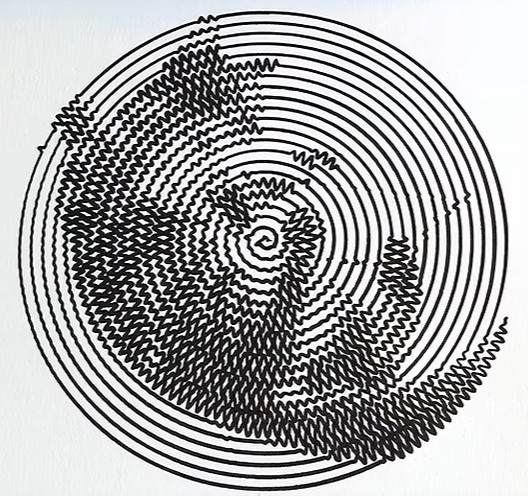
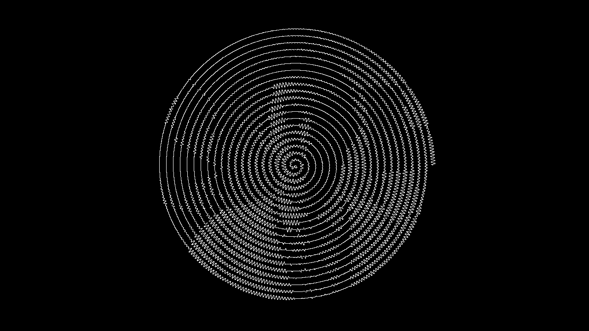
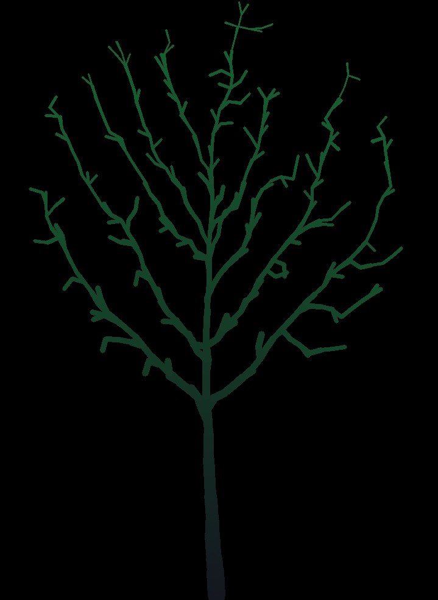

# Coding Curiosities

## Wiggle Draw
Inspired by Sebastian Lague's cat (as shown in "[I Tried Making a Pen Plotter to Draw Maps of the Moon](https://www.youtube.com/watch?v=qyNWDzO6kKQ)"):

Sebastian Lague's version, drawn using his robotic plotter

...and my version

## Marching Squares
Using the marching squares algorithm to draw isolines (contour lines) for a perlin noise pattern

### More Info
- Wikipedia article: https://en.wikipedia.org/wiki/Marching_squares

- The Programming Chaos YouTube channel: [Programming The Marching Squares Algorithm](https://www.youtube.com/watch?v=P45S7-OTrSE)

- Sebastian Lague's video about [Marching Cubes](https://www.youtube.com/watch?v=M3iI2l0ltbE)

## Space Colonization
An algorithm that mimics organic structures like trees, roots, rivers etc.

### More Info
- The "Programming Chaos" YouTube channel: [The Space Colonization Algorithm: Roads, Rivers, Trees & More](https://www.youtube.com/watch?v=Y6QLhjvytXk)

- Papers from the [Biological Modeling and Visualization research group in the Department of Computer Science at the University of Calgary.](algorithmicbotany.org)

    - [Modeling and visualization of leaf venation
patterns](https://algorithmicbotany.org/papers/venation.sig2005.pdf)

    - [Modeling Trees with a Space Colonization Algorithm](https://algorithmicbotany.org/papers/colonization.egwnp2007.large.pdf)
