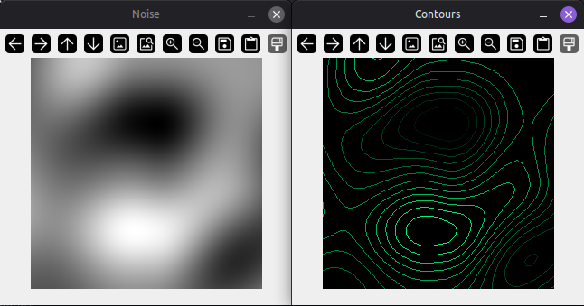
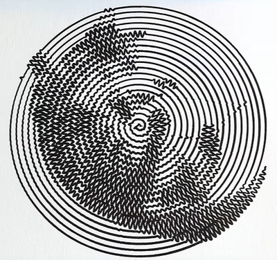
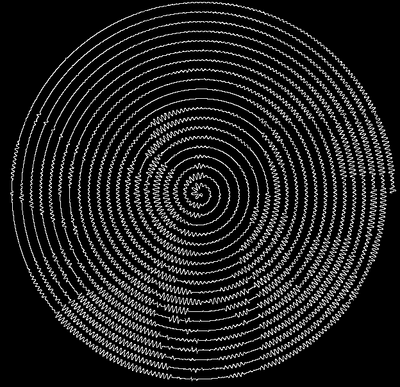
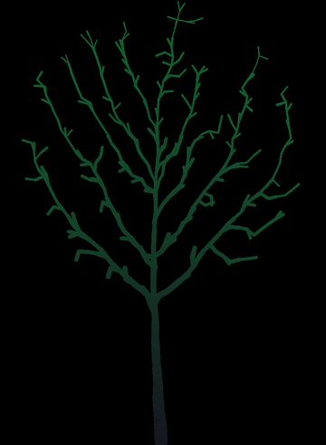

# Coding Curiosities

## Marching Squares
Using the marching squares algorithm to draw isolines (contour lines) for a perlin noise pattern

### Possible Extensions
- This generates the 3D perlin noise very slowly. Could it be optimised?
- Apply the algorithm to a different scalar field, i.e. replace the perlin noise with something else

### More Info
- Wikipedia article: https://en.wikipedia.org/wiki/Marching_squares

- The Programming Chaos YouTube channel: [Programming The Marching Squares Algorithm](https://www.youtube.com/watch?v=P45S7-OTrSE)

- Sebastian Lague's video about [Marching Cubes](https://www.youtube.com/watch?v=M3iI2l0ltbE)

## Wiggle Draw
Inspired by Sebastian Lague's cat (as shown in "[I Tried Making a Pen Plotter to Draw Maps of the Moon](https://www.youtube.com/watch?v=qyNWDzO6kKQ)"):

Sebastian Lague's version, drawn using his robotic plotter

...and my version

## Space Colonization
An algorithm that mimics organic structures like trees, roots, rivers etc.

### Possible Extensions
- Adapt for 3D
- Use spatial partitioning to speed up the process of finding nearest nodes. The method used here is very inefficient, check every node for every attractor 

### More Info
- The "Programming Chaos" YouTube channel: [The Space Colonization Algorithm: Roads, Rivers, Trees & More](https://www.youtube.com/watch?v=Y6QLhjvytXk)

- Papers from the [Biological Modeling and Visualization research group in the Department of Computer Science at the University of Calgary.](algorithmicbotany.org)

    - [Modeling and visualization of leaf venation
patterns](https://algorithmicbotany.org/papers/venation.sig2005.pdf)

    - [Modeling Trees with a Space Colonization Algorithm](https://algorithmicbotany.org/papers/colonization.egwnp2007.large.pdf)

## Maths Parser
### Shunting Yard Algorithm and Reverse Polish Notation

Evaluates expressions like `(1 + 2) * 3^2`:
- Tokenise the input string: `['(', '1', '+', '2', ')', '*', '3', '^', '2']`
- Produce reverse polish notation (RPN) using the _Shunting Yard_ algorithm  -> `['1', '2', '+', '3', '2', '^', '*']`
- Evaluate by working through the RPN, placing operands onto a stack and removing them when an operator is encountered -> `27`

### Possible Extensions
- Handle negative numbers in the original expression
- Deal with functions such as sin() and cos().

### More Info
- Wikipedia: 
- - [Shunting Yard Algorithm](https://en.wikipedia.org/wiki/Shunting_yard_algorithm)
- - [Reverse Polish Notation](https://en.wikipedia.org/wiki/Reverse_Polish_notation)
- Emory University: [examples and summary](https://mathcenter.oxford.emory.edu/site/cs171/shuntingYardAlgorithm/)

- Ada Computer Science: [Reverse Polish Notation](https://adacomputerscience.org/concepts/trans_rpn)